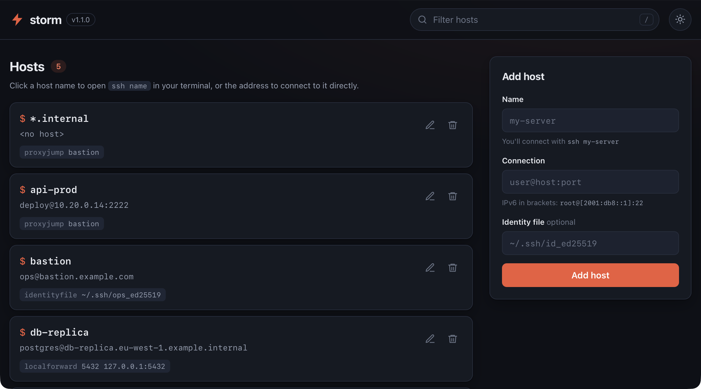

---

[](https://github.com/intrepidsilence/storm/actions/workflows/test.yml)

storm is a command line tool to manage your ssh connections.

**Requirements:** Python 3.11+

This is a maintained fork of [storm](https://pypi.org/project/stormssh/) by Emre Yilmaz. The original
GitHub repository (`emre/storm`) no longer exists; its last release was 0.7.0. See
[changes from the original](#changes-from-the-original-storm) below.

**features**

- adding, editing, deleting, listing, searching across your SSHConfig.
- command alias support for your CLI preferences.
- support for custom SSH directives.
- scriptable as a python library.
- a local web ui besides the cli, with one-click connect: host names open `ssh <name>` in your
  terminal.

#### installation

Install this fork straight from GitHub:

```bash
$ pip install git+https://github.com/intrepidsilence/storm.git
```

or from source:
```bash
$ git clone https://github.com/intrepidsilence/storm.git
$ cd storm
$ pip install .
```

> **Note:** `pip install stormssh` and the Arch Linux
> [python-stormssh](https://aur.archlinux.org/packages/python-stormssh) package still install the
> **original 0.7.0 release**, which runs on Python 2 era dependencies and has none of the fixes
> below. The Homebrew formula and the openSUSE and Void Linux packages have been removed upstream.

#### usage & documentation

See [docs/usage.rst](docs/usage.rst) for every command. The
[stormssh.readthedocs.io](https://stormssh.readthedocs.io/en/master/) site still exists but
documents the original 0.7.0 release.

#### screens


**web ui**



`storm web` opens a local page (dark by default; `--theme light` or `--theme auto` to follow
your system). Click a host's **name** to run `ssh <name>` in your terminal, so everything in your
ssh config for that host applies. Click its **address** to open `ssh://user@host:port` directly,
for ssh apps that keep their own host list and don't read `~/.ssh/config`. Either link goes to
whichever app your system has registered for `ssh://` links; if none is registered, nothing opens.

The web ui (`storm web`) only listens on `127.0.0.1` and only answers requests addressed to
`localhost`, `127.0.0.1` or `[::1]`.

#### changes from the original storm

Compared with the original 0.7.0 release:

**Platform**

- Python 3.11+ only; Python 2 support and its compatibility code are gone.
- Dependencies moved off their 2014-era versions, which have published CVEs: now paramiko 3.4+,
  Flask 3, Werkzeug 3 and termcolor 2.4+.
- Packaged with `pyproject.toml` (the old `setup.py` and `setup.cfg` were removed).
- Tests moved from nose to pytest, run on GitHub Actions against Python 3.11, 3.12 and 3.13, with
  100% line coverage.

**Security**

- Names, hostnames, users, ports, identity files and `--o` options that contain line breaks or
  other control characters are rejected. Previously a value such as a host name with an embedded
  newline could add arbitrary directives, including `ProxyCommand`, to your ssh config.
- The web ui no longer reflects the `?theme=` parameter into the page (a script injection hole),
  and it refuses requests addressed to any host other than this machine, which blocks DNS
  rebinding attacks.
- The web ui no longer uses AngularJS 1.0.8 (unsupported since 2021, with published
  vulnerabilities). It is plain JavaScript that inserts config values as text, never as HTML,
  and the page sends a Content-Security-Policy that blocks inline and third-party scripts and
  framing by other sites.
- `~/.ssh` is created with `0700` permissions, and `storm backup` copies the config's permission
  bits instead of creating a world-readable file.

**Reliability**

- Your ssh config is written atomically (to a temporary file that is then swapped in), keeps its
  permissions, and is written through a symlink instead of replacing it.
- Deleting your last host, or running `storm delete_all`, now actually empties the file.
- Deleting a host that appears more than once removes every copy.
- Values containing `=`, such as `SetEnv FOO=bar`, are kept intact instead of being mangled.
- Repeated `SendEnv`, `CertificateFile` and `DynamicForward` lines are kept instead of all but the
  first being dropped.
- Hosts added with `storm add` can be searched straight away.
- `--o key=value` accepts values containing `=`. An option without `=` is reported as an error
  instead of being silently ignored (`add`, `edit`) or crashing (`update`). An invalid regular
  expression given to `update` is reported as an error.
- Ports must be between 1 and 65535, and a connection uri must contain a host.

**Features**

- IPv6 addresses in connection uris: `'root@[2001:db8::1]:2222'`, or `root@2001:db8::1` without
  a port. Quote the bracketed form: zsh, the macOS default shell, treats `[...]` as a filename
  pattern. `storm list` and `storm search` show IPv6 hosts in the same bracketed form.
- `storm update --connection_uri` works (it was documented but ignored). It changes only the parts
  you write, so `storm update 'web-.*' --connection_uri new.example.com` keeps each host's user and
  port.
- `storm web` takes `--config` like every other command; `--ssh_config` still works.
- Redesigned web ui: dark by default with light and auto themes, a host list with one-click
  `ssh://` connect links, inline errors instead of pop-ups, delete confirmation, and a `/`
  shortcut for the filter. The old `modern`, `black` and `storm` theme names still work and map
  to light, dark and light.
- Works with paramiko up to 5.x and termcolor up to 3.x.
- The web ui returns `400` for invalid input, and removing an identity file from a host that has
  none no longer fails.
